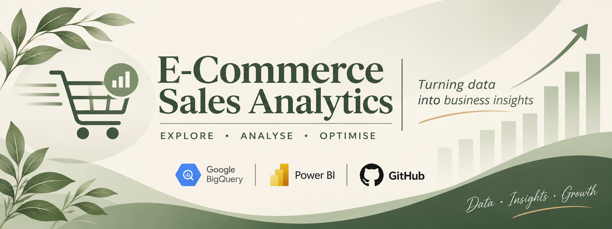

# bigquery-ecommerce-analytics

# E-Commerce Sales & Customer Analytics



## Project Overview

This project focuses on analysing Brazilian e-commerce data to identify sales trends, customer purchasing behaviour, product performance, and business opportunities.

Using **Google BigQuery, SQL, and Microsoft Power BI**, this project transforms raw e-commerce data into meaningful business insights through data analysis, data modelling, and interactive dashboard development.

## Project Objectives

- Analyse overall e-commerce sales performance.
- Identify monthly sales and order trends.
- Understand customer purchasing behaviour and repeat purchases.
- Identify top-performing products and product categories.
- Analyse geographical sales distribution.
- Evaluate order statuses and delivery performance.
- Develop an interactive Power BI dashboard to support business decision-making.

## Tools & Technologies

| Tool | Purpose |
|---|---|
| Google BigQuery | Cloud data storage and SQL analysis |
| SQL | Data exploration, joins, aggregations and business analysis |
| Microsoft Power BI | Data modelling, DAX and interactive visualisation |
| GitHub | Version control and project documentation |
| Kaggle | Dataset source |

## Dataset

**Dataset:** Brazilian E-Commerce Public Dataset by Olist

**Source:** [Kaggle – Brazilian E-Commerce Public Dataset](https://www.kaggle.com/datasets/olistbr/brazilian-ecommerce)

The dataset contains Brazilian e-commerce transactions and related information, including orders, customers, products, sellers, payments and reviews.

### Main Tables Used

| Table | Description |
|---|---|
| orders | Order information and order statuses |
| order_items | Products purchased, prices and freight values |
| customers | Customer IDs and geographical information |
| products | Product categories and product attributes |

## Project Workflow

1. **Data Collection:** Downloaded the Brazilian E-Commerce dataset from Kaggle.
2. **Data Loading:** Uploaded CSV files into Google BigQuery.
3. **Data Exploration:** Explored table structures, columns and records using SQL.
4. **Data Analysis:** Performed sales, customer, geographical and product analysis.
5. **Data Modelling:** Connected the four tables using relationships in Power BI.
6. **Dashboard Development:** Building KPI cards, charts and interactive reports using Power BI and DAX.
7. **Business Insights:** Identifying trends and opportunities from the analysis.

## SQL Analysis & Business Insights

### 1. Order Status Analysis

- Total recorded orders: 99,441.
- Delivered orders: 96,478.
- Delivered order percentage: 97.02%.
- Canceled orders: 625.

**Business Insight:** The majority of recorded orders have a delivered status. Further investigation of canceled and unavailable orders could help identify opportunities to improve order fulfilment.

### 2. Monthly Sales Analysis

- Highest sales month: November 2017.
- Sales in November 2017: R$1,010,271.37.
- Orders in November 2017: 7,451.

**Business Insight:** November 2017 recorded the highest sales and order volume in the analysed period.

### 3. Customer Analysis

- Unique customers with recorded orders: 96,096.
- Repeat customers: 2,997.
- Repeat customer percentage: 3.12%.
- One-time customers: 93,099.

**Business Insight:** The relatively low repeat-purchase percentage suggests an opportunity to improve customer retention through loyalty programmes, personalised promotions and targeted marketing campaigns.

### 4. Geographical Analysis

The highest order volumes were recorded in:

1. São Paulo (SP)
2. Rio de Janeiro (RJ)
3. Minas Gerais (MG)

**Business Insight:** These states represent important markets for the business and could be prioritised for marketing and operational planning.

### 5. Product Category Analysis

Top-performing categories by sales value:

| Product Category | Sales Value (BRL) |
|---|---:|
| Beauty & Health | R$1,258,681.34 |
| Watches & Gifts | R$1,205,005.68 |
| Bed, Bath & Table | R$1,036,988.68 |
| Sports & Leisure | R$988,048.97 |
| Computers & Accessories | R$911,954.32 |

**Business Insight:** Beauty & Health generated the highest sales among the categories returned in the analysis.

### 6. Overall Sales Performance

- Total order items: 112,650.
- Unique products sold: 32,951.
- Total product sales value: R$13,591,643.70.
- Total freight value: R$2,251,909.54.
- Average item price: R$120.65.

*Note: Product sales value is calculated using item prices and excludes freight. It is not net profit.*

## SQL Concepts Practised

- SELECT statements
- WHERE conditions
- GROUP BY and ORDER BY
- Aggregate functions (COUNT, SUM, AVG)
- DISTINCT and COUNTIF
- INNER JOIN and LEFT JOIN
- Common Table Expressions (CTEs)
- CASE statements
- Window functions
- Date functions
- Business KPI calculations

## Power BI Dashboard

The interactive dashboard is being developed using Microsoft Power BI.

### Planned Dashboard Pages

**1. Executive Overview**
- Total Sales
- Total Orders
- Total Customers
- Average Order Value
- Monthly Sales Trend
- Order Status Distribution

**2. Customer Analytics**
- Customer Distribution by State
- Repeat Customer Analysis
- Customer Purchasing Behaviour
- Customer Segmentation

**3. Product & Sales Analytics**
- Top 10 Products
- Sales by Product Category
- Average Product Price
- Product Sales Performance
- Freight Value Analysis

### Dashboard Preview

*Screenshots will be added after dashboard development is completed.*

## Repository Structure

```text
bigquery-ecommerce-analytics/
│
├── README.md
│
├── images/
│   └── ecommerce-sales-banner.png
│
├── sql/
│   ├── 01_data_exploration.sql
│   ├── 02_order_analysis.sql
│   ├── 03_customer_analysis.sql
│   ├── 04_sales_analysis.sql
│   └── 05_product_analysis.sql
│
├── documentation/
│   ├── business_requirements.md
│   ├── data_dictionary.md
│   └── business_insights.md
│
├── dashboard/
│   └── powerbi_dashboard_screenshots/
│
└── screenshots/
```

*The repository structure will be updated as the remaining project files are added.*

## Key Learning Outcomes

- Practical experience working with Google BigQuery.
- Writing SQL queries to solve business problems.
- Analysing large e-commerce datasets.
- Understanding relational data and table relationships.
- Creating business-focused KPIs.
- Developing interactive dashboards using Power BI.
- Translating data analysis into actionable business insights.

## Project Status

**In Progress**

SQL exploration and initial business analysis have been completed. Power BI dashboard development and additional analytical tasks are ongoing.

## Author

**Hiruni Siyambalapitiya**

BSc (Hons) in Information Technology

Interested in Data Analytics, Business Intelligence and Data-Driven Solutions.

[GitHub Profile](https://github.com/hiruni-siyambalapitiya)

---

*This project is developed for learning, portfolio development and practical application of SQL and Business Intelligence concepts.*
